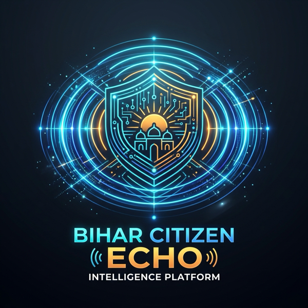
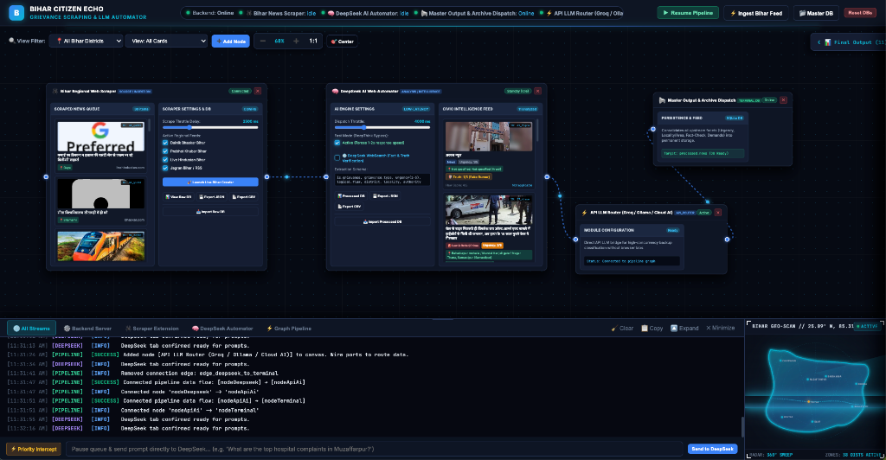

# 🇵🇰 Hyderabad Citizen Echo (Team Quantum) — Autonomous Civic Intelligence Platform

<p align="center">
  
</p>

<p align="center">
  <b>Enterprise-grade, distributed pipeline for autonomous news scraping, DeepSeek LLM classification, and real-time civic grievance surveillance across Hyderabad, Sindh, Pakistan.</b>
</p>

<p align="center">
  
  
  
  
  
  
</p>

---

## 🖥️ Platform Interface Preview

<p align="center">
  
</p>

<p align="center">
  <i>Figure 1: Modular Pipeline Canvas with dynamic particle edge flows, DeepSeek AI classification, multi-stream log terminal, and Hyderabad Geo-Radar scanning HUD.</i>
</p>

---

## 📑 Table of Contents
1. [Platform Interface Preview](#-platform-interface-preview)
2. [Overview & Problem Statement](#-overview--problem-statement)
3. [High-Level Architecture](#-high-level-architecture)
4. [The 4 Chrome Extensions](#-the-4-chrome-extensions)
5. [Interactive Node Canvas & Cyber HUD](#-interactive-node-canvas--cyber-hud)
6. [Quick Start (One-Command Runner)](#-quick-start-one-command-runner)
7. [Real-World Operating Workflow](#-real-world-operating-workflow)
8. [Priority Intercept (Custom User Queries)](#-priority-intercept-custom-user-queries)
9. [Database Schema & API Reference](#-database-schema--api-reference)
10. [Proprietary License](#-proprietary-license)

---

## 🏛️ Overview & Problem Statement

Public administration across Hyderabad, Sindh (*Qasimabad, Latifabad, City / Saddar, Paretabad, Tando Jam*) faces persistent civic challenges—monsoonal flooding, overflowing WASA sewage lines on Autobahn Road, Liaquat University Hospital (LUH / Civil Hospital) medical supply shortages, HESCO electricity breakdowns and 12–16 hour load-shedding, potholed roads, and uncollected municipal solid waste. Citizens voice these grievances daily across vernacular and national portals (*Daily Express Sindh, Daily Jang, Dawn News, Kawish, Daily Ibrat*), yet civic authorities lack a single unified real-time intelligence feed.

**Hyderabad Citizen Echo** solves this by bridging client-side web scraping, browser extension automation, asynchronous Python backend orchestration, and DeepSeek AI reasoning into an intuitive cybernetic canvas.

---

## ⚡ High-Level Architecture

```
                                  ┌────────────────────────────────────────────────────────┐
                                  │            PYTHON FASTAPI ORCHESTRATOR                │
                                  │             (Port 8000 // WebSocket Hub)              │
                                  │  - Central State & Flow Pipeline Engine               │
                                  │  - SQLite Async DB (grievance_hyderabad.db)           │
                                  │  - WebSocket Hub (/ws/hub) bi-directional broadcast   │
                                  │  - Dynamic Extension Auto-Discovery & Health Checks  │
                                  │  - Priority Intercept & Custom DeepSeek Dispatcher    │
                                  └───────────────────────────┬────────────────────────────┘
                                                              │
                    ┌─────────────────────────┬───────────────┴───────────────┬─────────────────────────┐
                    │ WebSocket               │ WebSocket                     │ WebSocket               │ WebSocket
                    ▼                         ▼                               ▼                         ▼
┌───────────────────────────────┐ ┌───────────────────────────────┐ ┌───────────────────────────────┐ ┌───────────────────────────────┐
│     CHROME EXTENSION 1        │ │     CHROME EXTENSION 2        │ │     CHROME EXTENSION 3        │ │     CHROME EXTENSION 4        │
│   Hyderabad News Scraper      │ │    DeepSeek AI Automator      │ │   Civic Severity Analyzer     │ │  Regional Fact-Checker Ext    │
│  - Multi-tab scraping loop    │ │  - Injected DOM controller    │ │  - Civic hazard scoring       │ │  - Cross-verifies claims      │
│  - Traverses new links        │ │    into chat.deepseek.com     │ │  - Hazard radius index        │ │  - Flags viral rumors         │
│  - Cleans Urdu text & media   │ │  - Turns off DeepThink (R1)   │ │  - Priority level & urgency   │ │  - Political bias detection   │
│  - High-speed batch push      │ │  - MutationObserver stream    │ │  - Department accountability  │ │  - Authenticity telemetry     │
└───────────────────────────────┘ └───────────────────────────────┘ └───────────────────────────────┘ └───────────────────────────────┘
                                                              │
                                                              ▼
                                  ┌────────────────────────────────────────────────────────┐
                                  │               FRONTEND CYBER CANVAS UI                 │
                                  │  - Infinite pannable/zoomable node canvas              │
                                  │  - Interactive Pipeline Nodes (Scraper, AI, Term)      │
                                  │  - Dynamic Edge Flow particle animations               │
                                  │  - Resizable Bottom Terminal Dock with Log Filters     │
                                  │  - Glowing Cyan Hyderabad Radar HUD with Laser Sweep   │
                                  │  - Rich News & Civic Intelligence Detail Modal         │
                                  └────────────────────────────────────────────────────────┘
```

---

## 🧩 The 4 Chrome Extensions

All extensions are located under `/extensions/` and conform to **Google Chrome Manifest V3**:

| Extension | Directory | Badge / Theme | Core Functionality |
| :--- | :--- | :--- | :--- |
| **Hyderabad News Scraper** | `extensions/bihar_news_scraper` | `cyan` / Broadcast | Automatically opens and cycles through new Hyderabad news links across major portals (*Daily Express, Daily Jang, Dawn, Kawish*), extracts full text, dates, zone markers, and media URLs, and pushes them directly to the backend intake queue. |
| **DeepSeek AI Automator** | `extensions/deepseek_automator` | `violet` / Neural | Injects a robust runtime script into `chat.deepseek.com`. Bypasses 45s DeepThink latency to achieve 3-5 second structured JSON classification. Intercepts newly generated responses via `MutationObserver` without requiring paid API keys. |
| **Civic Severity Analyzer** | `extensions/civic_severity_scorer` | `emerald` / Shield | Evaluates real-time civic impact, calculating urgency (Level 1–5), citizen hazard ratings, infrastructure vulnerability, and mapping responsible civic authorities (*WASA Hyderabad, HESCO, HMC, SSWMB, LUH*). |
| **Regional Fact-Checker** | `extensions/regional_fact_checker` | `sapphire` / Verify | Cross-verifies regional claims, detects unverified viral rumors, and filters out partisan political speeches from genuine civic grievances. |

---

## 🌐 Interactive Node Canvas & Cyber HUD

### 1. Visual Modular Node Canvas
- Drag-and-drop interactive nodes: **Scraper Node**, **DeepSeek AI Classifier Node**, and **Terminal Output Node**.
- Dynamic SVG spline wires with animated glowing particle pulses representing live data transmission.
- Add and remove custom nodes dynamically from the top toolbar.

### 2. Glowing Bluish-Cyan Hyderabad Radar HUD
- Located on the far right of the terminal dock, formatted as a **dynamic 1:1 square dock**.
- **Resizing Resilience**: Resizing the terminal dock (via the drag handle or toggle buttons) automatically resizes the right dock while preserving its exact square aspect ratio.
- **Accurate Hyderabad Map**: Glowing cyan boundary with the River Indus (Sindh Darya) and Kotri Barrage traversed along the western flank.
- **Continuous Laser Scanner**: A high-tech horizontal laser line sweeps top-to-bottom across Hyderabad with a cyan drop-shadow.
- **360° Conic Sweep**: A radar sweep beam rotates around the city.
- **Active Zone Hotspots**: Pulsing beacon rings over City / Saddar, Qasimabad, Latifabad, Autobahn Road, Paretabad / Phuleli, Tando Jam, and Kotri / Jamshoro with live telemetry hover tooltips.

---

## 🚀 Quick Start (One-Command Runner)

### Prerequisites
- Python 3.10 or higher
- Google Chrome (or Chromium-based browser)

### Single Command Launch
From the project root, run:
```bash
./run.sh
```
*(On Windows or alternative shells, run `python run.py`)*

The script will:
1. Automatically create and configure the `.venv` virtual environment.
2. Install all dependencies from `requirements.txt`.
3. Check and free Port 8000 if occupied by a stale process.
4. Launch FastAPI & Uvicorn with auto-reload at **[http://localhost:8000](http://localhost:8000)**.

---

## 📖 Real-World Operating Workflow

### Step 1: Load Extensions in Chrome
1. Open Google Chrome and navigate to `chrome://extensions/`.
2. Enable **Developer mode** (toggle in top right).
3. Click **"Load unpacked"** and select:
   - `extensions/bihar_news_scraper` (Hyderabad News Scraper)
   - `extensions/deepseek_automator`
   - *(Optional)* `extensions/civic_severity_scorer`
   - *(Optional)* `extensions/regional_fact_checker`

### Step 2: Open DeepSeek Chat
1. Open a new tab and go to **[https://chat.deepseek.com](https://chat.deepseek.com)**.
2. Log in. The **DeepSeek AI Automator** extension connects automatically.
3. The dashboard navbar at `http://localhost:8000` will turn green: `DeepSeek Ext: Ready / Idle`.

### Step 3: Start Autonomous Pipeline
1. On the dashboard (`http://localhost:8000`), click **"▶ Start Pipeline"**.
2. Click **"Scrape"** on the Scraper Node (or click the extension popup).
3. The scraper visits regional news links, ingests raw articles, streams them to DeepSeek for instant LLM classification, and saves structured civic records to the SQLite database.
4. Click any news entry in the processed table to view the full **News & Civic Intelligence Detail Modal**.

---

## ⚡ Priority Intercept (Custom User Queries)

Need to ask DeepSeek an immediate civic or analytical question without disrupting the automated pipeline?
1. In the bottom terminal dock, locate the **⚡ Priority Intercept** bar.
2. Type any question (e.g., *"What are the top hospital complaints at LUH Hyderabad?"* or *"Analyze recent WASA sewage issues on Autobahn Road"*).
3. Click **"Send to DeepSeek"**.
4. The system pauses the automated news queue, injects your query with top priority into DeepSeek, streams the response directly to your terminal, and resumes the automated queue seamlessly.

---

## 🗄️ Database Schema & API Reference

### SQLite Schema (`backend/grievance_hyderabad.db`)
- **`raw_news`**: Stores incoming scraped news items (`id`, `title`, `url`, `source`, `raw_text`, `published_at`, `status`).
- **`processed_news`**: Stores structured AI classifications (`is_grievance`, `is_political`, `grievance_type`, `urgency_level`, `logical_flaw_rating`, `district`, `block`, `locality`, `responsible_authority`, `key_demands`, `media_urls`, `deepseek_response`).
- **`audit_logs`**: Multi-stream system audit logs (`SYSTEM`, `SCRAPER`, `DEEPSEEK`, `PIPELINE`).

### Key REST API Endpoints
| Method | Endpoint | Description |
| :--- | :--- | :--- |
| `GET` | `/api/status` | Returns pipeline running state and extension statuses. |
| `GET` | `/api/health` | Liveness health probe for orchestrator services. |
| `GET` | `/api/metrics` | System telemetry metrics (ingestion rates, ratios, worker counts). |
| `GET` | `/api/analytics/district_hotspots` | Aggregated grievance density ranking across Hyderabad zones. |
| `POST` | `/api/pipeline/toggle` | Starts or pauses the global pipeline. |
| `GET` | `/api/raw_news` | Retrieves queued raw news items. |
| `GET` | `/api/processed_news` | Retrieves classified civic grievance intelligence records. |
| `POST` | `/api/ai/inject_query` | Priority Intercept query dispatcher to DeepSeek. |
| `POST` | `/api/db/reset` | Resets the SQLite database tables and queues. |
| `WS` | `/ws/hub` | Real-time bi-directional WebSocket hub for extensions and frontend. |

---

## 🧪 Automated Testing & Continuous Integration

The platform includes an automated testing suite run on Python 3.10, 3.11, 3.12, and 3.13:

```bash
# Run unit test suite
python -m unittest discover tests -v

# Run system integration test
python test_system.py
```

---

## 👥 Engineering Team & Contributors

Developed as an iterative, cross-functional civic intelligence platform:

- **Harsh** ([@h-990](https://github.com/h-990)) — *Lead Platform Architect*
- **iamdd07** ([@iamdd07](https://github.com/iamdd07)) — *Scraping Ingestion & Extension Suite*
- **Namrata Mishra** ([@namratamishra8429-oss](https://github.com/namratamishra8429-oss)) — *Geo-Analytics & Civic Severity Engine*

---

## 🔒 Proprietary License

**Copyright (c) 2026 Team Quantum / Hyderabad Citizen Echo Project. All rights reserved.**

This software is strictly proprietary and confidential. Unauthorized copying, modification, redistribution, or commercial use is strictly prohibited. See the [LICENSE](LICENSE) file for complete terms.
